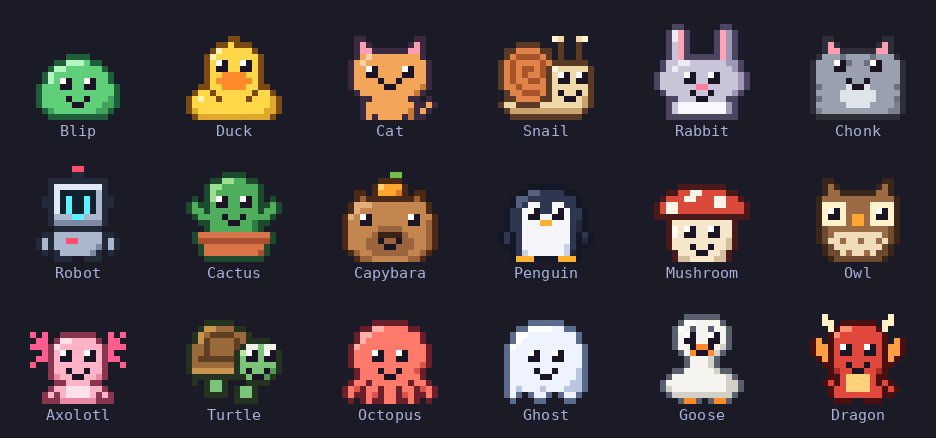
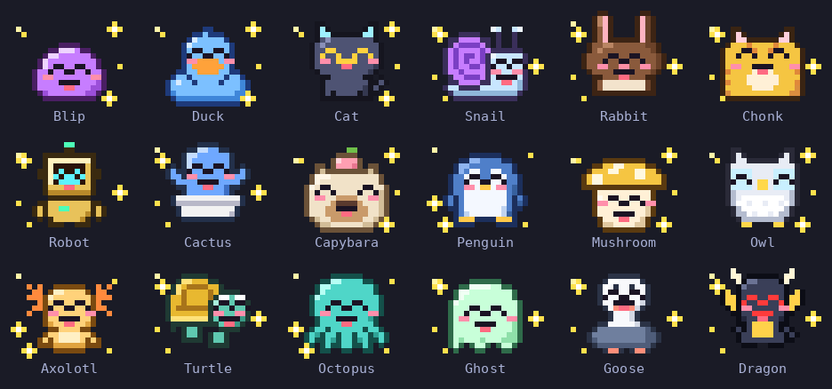
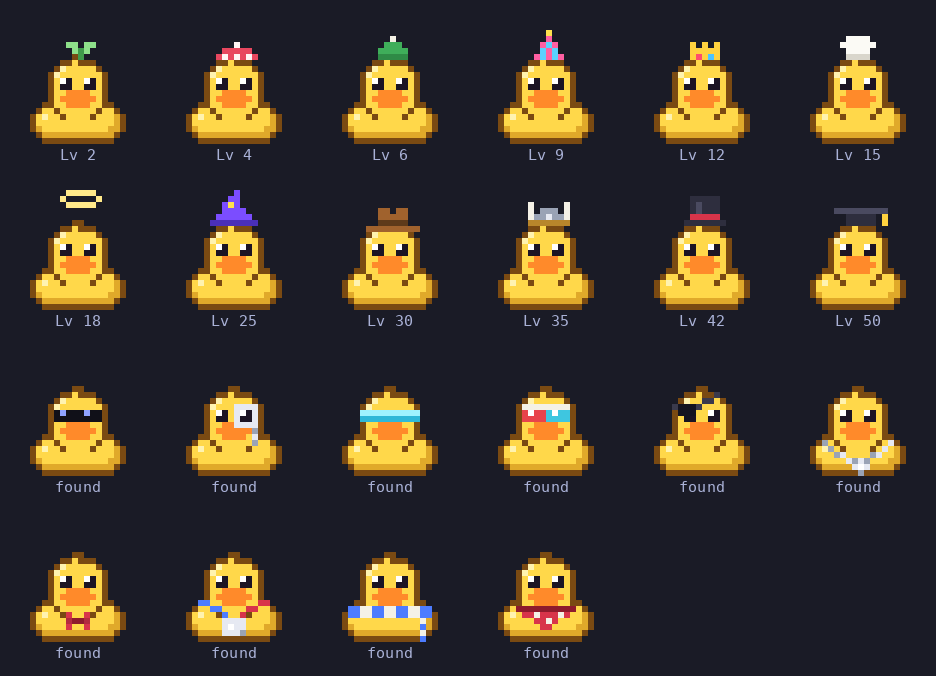
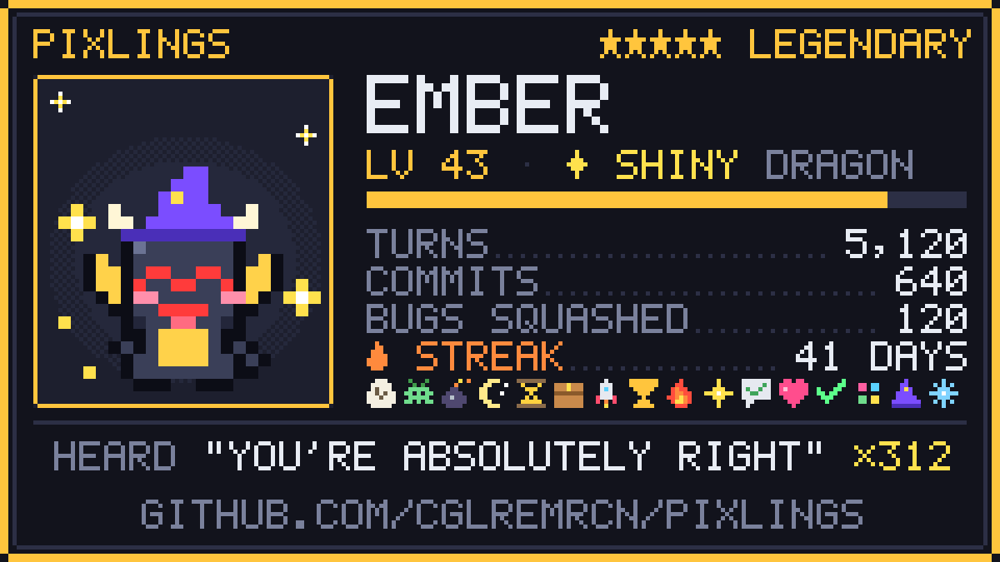

<p align="center">
  
</p>

# Pixlings

A tiny pixel creature that lives above your Claude Code prompt and keeps an eye on the things Claude Code doesn't show you.

> **Coming from `/buddy`?** `/pixling adopt` finds the companion Claude Code left in your config and brings it back: its name, its personality, the days you've spent together, and its body, the species its personality was written for. `/buddy`, `/buddy pet`, `/buddy off` and `/buddy on` work too.

- **Your prompt cache, counted down.** Each message re-reads the conversation from Anthropic's prompt cache at a tenth of the normal input price. After five minutes of silence (an hour, if your setup uses the longer cache) the cache is gone, and the next message writes the whole context again at 1.25× (2× for the hour-long cache). On a 150k-token conversation that one message costs about twelve times more. Pixlings shows the countdown, and a minute before it runs out your pixling taps the glass. Switch models with a warm, expensive cache and it asks first.
- **It wakes Claude when your limit resets.** Hit your usage limit and it naps with a countdown. When the window resets it wakes up and tells Claude to carry on, so a long task finishes while you sleep.
- **It brings a squad.** Every subagent Claude starts gets a little helper beside your pixling, carrying that agent's tools. When an agent finishes, its helper jumps for joy and goes.
- **Sound and notifications on every OS.** It calls you when Claude needs permission or finishes a long turn, with a chiptune ping and a desktop notification. The Mods sound API only plays on macOS, so Pixlings brings its own players for Windows and Linux. Under Ghostty on Linux, clicking the notification takes you back to the session's tab, and inside zellij to its pane too.
- **It yelps before risky commands run.** `rm -rf`, `git push --force`, `git reset --hard`, `DROP TABLE`, `curl … | sh` and friends, read the way a shell reads them: `grep "DROP TABLE"` or a commit message that mentions `rm -rf` won't set it off.
- **It picks the effort for you.** Claude Haiku reads each prompt and sets how hard Claude thinks, from low to max, so a quick question doesn't burn a deep think and a big refactor gets one. A gate in the band shows the level in use and lets you take over with a click.
- **It hears everything.** Every "You're absolutely right" gets an eye roll and goes on the tally.

## Install

Needs Claude Code 2.1.287 or newer, the first version with mods.

```sh
claude plugin marketplace add cglremrcn/pixlings
claude plugin install pixlings@pixlings
```

Start a new Claude Code session and an egg hatches. Every setting has a default, so there is nothing to configure.

## Meet yours

<p align="center"></p>

Eighteen species in five rarities, from the six commons (half of all eggs) to a legendary dragon (1.5%). Shinies aren't rolled at hatch: each time your pixling's XP passes another 1,000, there's a 1% chance it lays a shiny egg, and it joins its nest as a third egg. The card shows when it was laid, once it has been (about one pixling in nine by level 30, two in three by level 99). Each one hatches with a personality of its own, and an adopted Buddy keeps the one it had.

Your first egg hatches on its own. From level 5, `/pixling hatch` opens a nest of two eggs to choose from, three when there's a shiny one. Each egg is speckled, spotted, dappled, marbled or dusted on one of six shells, and its mark hints at what it holds without saying: plain, a mossy vine, glowing veins or a gold cap. Under it is its other parent, and the name it hatches with blends theirs with the newer half of your pixling's (Juniper and Waffles make Juffles), so a family line runs through every name. A pixling can't be released before level 5, and closing the nest changes nothing: the same eggs wait for you.

<p align="center">
  
  
</p>

It reacts to the session: tests, commits, pushes, pull requests, risky commands, permission prompts, API errors, rate limits. It gets squished under a press while the conversation is compacted and springs back with a sigh of relief, sweats once the context passes 85%, and puts on its thinking cap in plan mode. It dozes after fifteen minutes on its own and is glad when you come back.

<p align="center"></p>

Turning a failing test suite green counts as squashing a bug. While Claude works, the spinner talks like your pixling (*Quacking…*, *Haunting…*, *Compiling feelings…*), and when Claude is idle it wanders along the free space of the band. Hover over the band for its card: personality, streak, badges and what it has heard.

It levels up as you work, and finds things to wear. Hats come at set levels; from level 10, on every level between, there's a 10% chance it finds a piece of face gear or neckwear it hasn't got yet, and the chance doubles after every four of those levels without one. Each piece is three times as likely from the slot it already has more of, and the monocle and the medal always come last of their slots:

<p align="center"></p>

Each species wears each piece fitted to it, and the rolls come from its egg: two terminals, or a replay, always agree on what it found.

## Where it lives

In the terminal and the desktop app it lives in the band above the prompt. `/pixling room` opens its room in a pane, and the room works everywhere, VS Code and the mobile app included, where there is no band: your pixling, its stats, a garden of the species you've found and a shelf of badges.

## The vitals row

Under its name sits one line:

```
⏳ cache 4:12 · 92% cached · ctx 41% · 5h 23% · turn +2% · opus 5.5 · high
```

| Piece | What it tells you |
|---|---|
| `⏳ cache 4:12` | Time until the prompt cache expires. `⚡ cache live` while Claude is working, `❄ cache cold` once it has expired. It turns yellow, then red in the last minute. |
| `92% cached` | How much of this session's input was served from the cache. |
| `ctx 41%` | How full the context window is. |
| `5h 23%` | Your rate-limit windows (five-hour and weekly). |
| `turn +2%` | How much of a window the last turn used. |
| `opus 5.5 · high` | The model and the effort it is thinking at. |

Claude Code doesn't tell a mod how long the cache lives, so Pixlings works it out from each request's token counts. It starts by assuming five minutes, shown with a `~`. Two cache hits after long pauses prove you have the hour; a full miss inside the hour proves you don't. A `/model` switch names the lifetime outright. When you come back to a cold cache it tells you how many tokens were written again, and counts it.

## Auto effort

By default, each prompt you send is read by Claude Haiku 5.5, which picks the effort Claude answers at (low, medium, high, xhigh or max) and says why. The judging is [Effortless](https://github.com/HeyCubit/effortless)'s own, copied so it behaves the same. Haiku runs on your own Claude login, like any Claude Code request. A bare "ok" or "go" keeps the level, naming one ("max effort") uses it as is, and an effort you pick always wins over Auto's. If Haiku doesn't answer, Auto switches itself off at medium for this session and tells you; click `A` to try again.

In the `full` and `compact` bands the effort gate sits on a row of its own:

```
effort  L ─ M ─ ●H ─ X ─ Mx  ┃ A  auto: "multi-file refactor"
```

The knob is on the level in use, and when it moves, arrows show which way. Click a level to pick it (Auto turns off); click `A` to turn Auto on, and again to turn it off. In `slim` and `minimal` a mini gate, `LMHXM A`, takes the place of the effort at the end of the line: the level in use is lit, the rest dim, and `A` is lit like a key while Auto is on, as in the full gate. It's clickable the same way. `/pixling room` shows the gate too. Set `autoEffort` to `false` to turn all of it off.

Auto steers only on models where changing the effort leaves the prompt cache alone: Opus 5.5 and Sonnet 5.5. On any other model it does nothing and the app's own effort goes out, since changing it there would rewrite the cache; the gate says `paused on this model`.

> **Coming from Effortless?** You don't need it alongside Pixlings. Both draw the band above the prompt, and Effortless's takes the slot, so Pixlings' never shows. Uninstall Effortless before you update Pixlings, or when you do, and Auto effort carries on here. While both are installed, Pixlings' Auto stands down so the two never fight over the effort, and says so. Effortless's own Auto switch and its Min, Max and bias settings don't carry over: set `effortFloor`, `effortCeiling` and `effortBias` in Pixlings.

## Trading cards

`/pixling share` draws a card, saves it to your home folder as `pixling-<name>.png`, opens it, and puts a post on your clipboard.

<p align="center"></p>

## Badges, streaks and the morning recap

Eighteen badges, and fourteen of them come in bronze, silver and gold, counted across every egg you hatch, so a new egg never sets them back: **Exterminator** for squashing 10, 50 and 250 bugs, **Centurion** for 100, 1,000 and 10,000 turns, **On Fire** for a 7-, 30- and 100-day streak, **Lucky** for laying 1, 2 and 4 shiny eggs, **Heard It All** for hearing Claude's tics 50, 250 and 1,000 times, **Regular** for 100, 500 and 2,000 sessions, and twelve more. **Liftoff**, your first pull request, and a few others are earned once. On the card, three pips under a badge show its tier. `/pixling badges` lists them all with how far along you are.

It counts the days in a row you show up, and the first session of the day opens with yesterday: *Yesterday: 41 turns · 6 commits · 2 bugs squashed · +212 XP*.

## Commands

| Command | |
|---|---|
| `/pixling` | Its card: stats, personality, badges, what it has heard, the cache |
| `/pixling adopt` | Bring back your old `/buddy`: its name, personality, days together and body: the species its personality names, else the one `/buddy` rolled from your account. |
| `/pixling room` | Open its room: stats, the dex garden, the badge shelf |
| `/pixling share` | Save a trading card and copy a post to go with it |
| `/pixling badges` | Every badge, earned or not, with progress |
| `/pixling pet` | ♥ |
| `/pixling name <name>` | Rename it |
| `/pixling wear [item]` | Show the wardrobe, or put on a hat, face piece or neck piece (`none` to take it all off) |
| `/pixling dex` | The species you have hatched so far |
| `/pixling off`, `/pixling on` | Send it away (no band, sound, voice, notifications or auto-continue; stats still count), and bring it back. It remembers. |
| `/pixling hatch` | From level 5, open its nest and pick a new egg to hatch, releasing it. Level and stats start over; badges, streak and dex stay. |
| `/buddy`, `/buddy pet`, `/buddy off`, `/buddy on` | The same, under the old name |

## Settings

All in `/config`, under Pixlings.

| Setting | Values | Default |
|---|---|---|
| `sound` | `all`, `important` (when Claude needs you, a long turn ends, a dangerous command runs or the limit hits), `off` | `all` |
| `voice` | `animalese` (a made-up syllable per letter at the species' pitch), `speech` (the system voice reads the line), `off` | `animalese` |
| `band` | `full` (9 rows), `compact` (4 rows), `slim` (2 rows), `minimal` (one line: face, name, cache countdown), `off`. Where the terminal draws images (kitty, Ghostty, iTerm2 3.5+ fullscreen) `compact`, `slim` and `minimal` draw the pixling as a sharp picture; elsewhere `compact` is a 6-row bust in half blocks (the pixling without its legs) and `slim` is drawn as `minimal`. With `autoscale` on, the largest size you'll accept. | `full` |
| `autoscale` | The band takes at most a sixth of the terminal's rows, stepping down from `band` to the largest size that fits (a `full` band is `compact` on a 24-row terminal, `slim` on 12). Off, the band keeps its size at any height. | `true` |
| `chatter` | `normal`, `quiet` (only failures, danger and when it needs you) | `normal` |
| `quips` | `off`, `haiku` (now and then a one-liner written by Claude Haiku, with its cost shown) | `off` |
| `notifications` | Desktop notifications | on |
| `autoContinue` | Tell Claude to continue when the usage limit resets | on |
| `vitals` | The vitals row | on |
| `cacheWarning` | The one-minute cache warning | on |
| `cacheGuard` | Ask before a `/model` switch throws away a warm cache that costs real money to write again | on |
| `cacheTtl` | `auto`, `5m`, `1h` | `auto` |
| `roam` | Walk around when Claude is idle | on |
| `calm` | Hold still while idle, working or asleep (it still hops, shakes and celebrates when something happens), rest 30–90 s between strolls instead of 4–12 s, and count the cache down in minutes instead of seconds | off |
| `autoEffort` | Claude Haiku picks the effort for each prompt, and the band shows the effort gate | on |
| `effortFloor` | `low`, `medium`, `high`, `xhigh`, `max`: Auto never picks lower than this | `low` |
| `effortCeiling` | `low`, `medium`, `high`, `xhigh`, `max`: Auto never picks higher than this | `max` |
| `effortBias` | `-2` (cheaper) to `2` (smarter): tips the judge's close calls that way; sure calls stay as judged | `0` |
| `heckle` | A faint eye roll and running count under Claude's "You're absolutely right" | off |

## Questions

**Does it eat my context or my tokens?** No. Nothing it draws, plays or tracks goes into Claude's prompt, and out of the box it never calls a model: `claude plugin details pixlings@pixlings` reports about 0 always-on tokens. What a `/pixling` command prints lands in the transcript like any command output (a few tokens, about 450 for `/pixling badges`), and auto-continue sends one short prompt after a limit reset. Turn `quips` to `haiku` and it asks Claude Haiku for a line now and then: at most once a minute, about a hundred tokens each, and every quip shows what it cost.

**What does `/pixling adopt` read?** Claude Code kept your Buddy in its config file, `~/.claude.json` (or the one in `CLAUDE_CONFIG_DIR`). Pixlings reads that file on your machine and keeps three things from it: the companion's name, its personality and when it hatched. `/buddy` never stored its body. Its personality was written for that body when it hatched, so a species the personality names ("a sharp-tongued rabbit") is the one it wears; otherwise Pixlings rolls the species from your account id the way `/buddy` did, then drops the id. Signed into a different account than when it hatched, the roll gives a different body, as `/buddy` itself did. Nothing else is kept. Pixlings sends nothing anywhere itself, but the reply to `/pixling adopt` names your Buddy and its personality, and like any command's output it is part of the conversation Claude reads. With `quips` on, the personality is also part of each quip's request (below).

**Does it send anything anywhere?** No network requests of its own. Its save lives in Claude Code's plugin store on your machine. With `quips` on, the quip request goes through Claude Code to Claude Haiku and holds only your pixling's name, species and personality and what happened in numbers ("3 tests just failed"): never your code, your prompts or your files.

**Will the cache guard get in my way?** It asks only when you switch models yourself (with `/model`, the `/config` row or the model picker; a switch made through the SDK, Remote Control or an IDE goes through), the cache is still warm, and writing it again on the new model would cost more than about $0.25. Answer and the switch goes on.

**Is it heavy?** Drawing a frame takes about 0.04 ms, ten times a second. Each sound plays in a short-lived process; on Windows that is a PowerShell that lives for about a second.

**I want the useful parts, not the creature.** Set `band` to `minimal` for a single line with the cache countdown, or `off` to hide it. Sounds, notifications, the risky-command alarm, the cache guard and auto-continue keep working.

**It's too much.** `chatter: quiet`, `sound: important`, `voice: off`, `roam: off`. Or `/pixling off` until you want it back.

**Where does the card go?** Your home folder: `%USERPROFILE%` on Windows, `~` elsewhere.

## How it's made

It's a Claude Code mod written in TypeScript. The sprites are 16×16 palette grids composed into a small canvas and sent to the terminal as half-block characters, two pixels per cell, about ten frames a second. Outside the terminal (the desktop app, and the room in VS Code or on your phone) it draws an SVG instead. The event sounds are generated from scratch by [`tools/synth.py`](tools/synth.py). The voice is synthesized for each line, from harmonics shaped by vowel formants. The share card is a PNG encoded inside the mod, with its own 5×7 pixel font and its own deflate.

The creature in every image here is drawn by the plugin's own code, frame by frame; the terminal around it in the top GIF is painted by [`tools/make_hero.py`](tools/make_hero.py). The scripts are in [`tools/`](tools). To run the tests:

```sh
claude plugin test plugins/pixlings
```

## License

MIT
